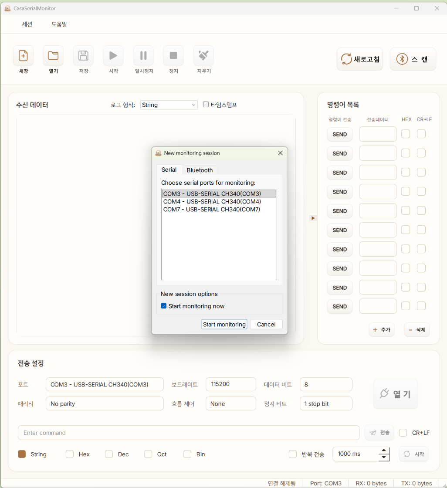

# CasaSerial

PyQt6와 pyserial 기반의 크로스 플랫폼 시리얼 포트 모니터입니다. Windows 10/11과 macOS를 지원합니다.



## 주요 기능

- **포트 스캔**: 시작할 때 사용 가능한 시리얼 포트를 검색하고, `새로고침` 버튼으로 다시 검색
- **연결 설정**: Port, Baudrate, Databits, Parity, Flow control, Stopbits
- **멀티 세션(MDI)**: New Session 다이얼로그의 `Serial` / `Bluetooth` 탭에서 포트 또는 BLE 장치를 골라 여러 세션을 동시에 모니터링
- **송신**: String / Hex / Dec / Oct / Bin 포맷, 입력 유효성 검사 및 자동 포맷, CR+LF 옵션
- **블루투스(BLE)**: 툴바의 `블루투스 스캔`으로 주변 장치를 검색하고(이름/주소 필터), Nordic UART Service(NUS) 장치에 연결. 연결되면 버튼이 `블루투스 연결종료`로 바뀜. 연결된 세션에서도 시리얼과 동일하게 송수신 가능
- **반복 송신**: 주기적 자동 송신 (Start/Stop loop)
- **CMD 패널**: 자주 쓰는 명령을 행 단위로 추가/삭제하며 관리
- **로그 뷰**: RX/TX/ERR/SESSION 카테고리별 색상, Timestamp 표시, Dump view, 최대 5000라인
- **UI**: 한국어, 웜 베이지 테마, 반응형 레이아웃

## 요구 사항

- Python 3.10 이상
- PyQt6 >= 6.6
- pyserial >= 3.5
- bleak >= 0.22 (블루투스 LE)

## 설치 및 실행

```powershell
pip install -r requirements.txt
python main.py
```

- Windows: `run.bat` 실행 (`.venv`가 있으면 자동 사용)
- macOS: `./run_mac.sh`

## 빌드 (PyInstaller)

| 플랫폼 | 명령 | 결과 |
| --- | --- | --- |
| Windows | `.\build_win.bat` | `WIN\CasaSerial\CasaSerial.exe` |
| Windows 설치 파일 | `.\build_setup.bat` (Inno Setup 필요) | `WIN\Setup\CasaSerial_Setup_<버전>.exe` |
| macOS | `./build_mac.sh` | `MAC/CasaSerial.app` |

자세한 내용은 [packaging.md](packaging.md)를 참고하세요.

## 파일 구조

| 파일 | 설명 |
| --- | --- |
| `main.py` | 앱 진입점 |
| `main_window.py` | 메인 윈도우 (UI, 포트 스캔, 설정 매핑, 이벤트 처리) |
| `monitor_subwindow.py` | 세션별 MDI 모니터 서브 윈도우 |
| `new_session_dialog.py` | New Session 다이얼로그 |
| `serial_worker.py` | `QThread` 기반 시리얼 I/O 워커 |
| `ble_worker.py` | BLE(Nordic UART) 연결 워커와 장치 스캐너 |
| `ble_scan_dialog.py` | 블루투스 스캔 다이얼로그 (필터, 장치 목록, 연결) |
| `settings.py` | `SerialSettings` 데이터클래스 |
| `app_resources.py` | 리소스 경로 처리 |
| `UI/`, `image/`, `Fonts/` | UI 파일, 이미지, 폰트 |

## 문서

- [History.md](History.md): 개발 이력 (작업 내용 지속 기록)
- [packaging.md](packaging.md): 패키징 가이드
- [memory.md](memory.md): 작업 재개용 메모

## 로드맵

- 파일 송신 기능 (`QFileDialog`, chunk 단위 송신)
- Bridge 모드 (가상 포트 기반 소프트웨어 시리얼 프록시)

자세한 계획은 [History.md](History.md)의 "나중에 할 일"을 참고하세요.
